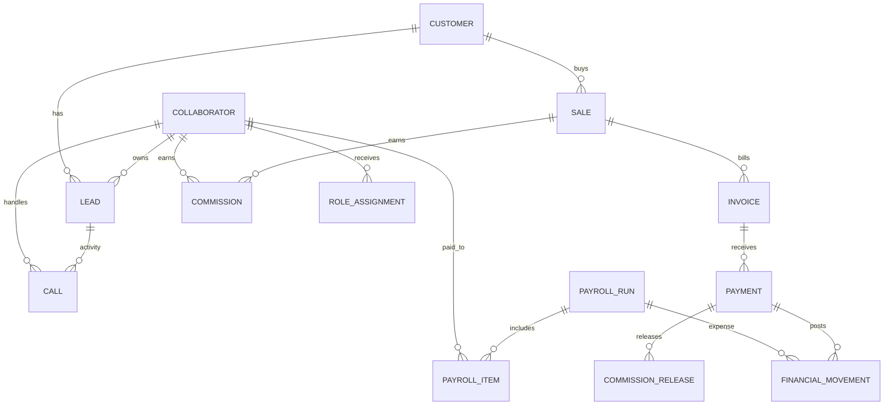

# Kaivincia — Design System e integração modular

## Decisão de arquitetura
Adotar um **monólito modular com eventos de domínio**, mantendo React/Vite, Firebase Auth/Firestore e as rotas atuais. Não começar com microserviços: uma equipa de 2–5 pessoas ganha limites claros sem duplicar deploy, observabilidade e autenticação. Para finanças, usar transações + outbox e consumidores idempotentes; se a carga exigir, evoluir para Node.js + PostgreSQL + Redis/BullMQ mantendo os contratos.

## Design System macOS-inspired
- Tipografia do sistema: `-apple-system, BlinkMacSystemFont, "SF Pro Text", "SF Pro Display", "Segoe UI", sans-serif`; não incorporar fontes proprietárias Apple.
- Espaçamento: 4, 8, 12, 16, 20, 24, 32, 40 px. Raios: 8, 12, 16, 22 px.
- Light: #F5F5F7 / superfície #FFFFFF / texto #1D1D1F / secundário #6E6E73 / accent #007AFF.
- Dark: #1C1C1E / superfície #2C2C2E / texto #F5F5F7 / secundário #A1A1A6 / accent #0A84FF.
- Glass (blur 24–28px, saturação 1.5): usar apenas em sidebar, topbar, popovers e sheets; tabelas e conteúdo crítico devem manter contraste opaco.
- Motion: 140/220/360 ms; `prefers-reduced-motion` reduz animação.
- Componentes reutilizáveis em `src/components/design-system/NativeUI.tsx`: KaiCard, KaiButton, KaiTable, KaiModal, KaiToast.
- A shell existente já tem sidebar, breadcrumbs e CommandBar ⌘K. Tokens são aditivos e scoped; migrar cada página gradualmente, não substituir rotas nem componentes de negócio de uma vez.
- Alinhamento Apple HIG: hierarquia, consistência, feedback imediato, acessibilidade, foco visível e controles previsíveis. Liquid Glass é material, não deve comprometer legibilidade.

## Modelo relacional alvo


### Campos mínimos
- Collaborator: id, authUid, emailNormalized, displayName, status, managerId, teamId, roleAssignments, assignedDids, timezone, googleCalendarConnectionStatus.
- Customer: id, legalName, taxId (sensível), email, phones, ownerId, consentFlags, createdAt.
- Lead: id, customerId?, source, stage, ownerId, campaignId, estimatedValueMinor, currency, nextActionAt.
- Sale: id, leadId, customerId, ownerId, productId, status, grossMinor, discountMinor, currency, closedAt, idempotencyKey.
- Invoice: id, saleId, customerId, amountMinor, balanceMinor, dueAt, status.
- Payment: id, invoiceId, amountMinor, currency, receivedAt, method, providerReference, idempotencyKey.
- Commission: id, saleId, collaboratorId, ruleVersionId, basisAmountMinor, accruedMinor, releasedMinor, status, periodId.
- PayrollRun/Item: id, periodStart/end, status, collaboratorId, conceptCode, amountMinor, sourceType/sourceId, approval metadata.
- FinancialMovement: id, direction, accountCode, amountMinor, currency, occurredAt, sourceType/sourceId, reconciliationStatus.
- Call: id, telnyxCallControlId, collaboratorId, customerId?, leadId?, direction, fromDid, toNumber, startedAt, answeredAt, endedAt, durationSeconds, disposition, recordingRef, webhookEventId.
- RoleAssignment: collaboratorId, roleId, scopeType, scopeId, permissionSet, grantedBy, expiresAt.
- OutboxEvent: id, aggregateType/id, eventType, schemaVersion, payload, occurredAt, publishedAt, attempts, idempotencyKey.

## Eventos de domínio
| Evento | Productor → consumidores | Comportamiento |
|---|---|---|
| sale.closed.v1 | Ventas → Facturación/Comisiones | Cierra venta y crea outbox en la misma transacción |
| payment.received.v1 | Cobros → Comisiones/Financiero | Deduplica por referencia, reduce saldo y libera comisión proporcional |
| commission.calculated.v1 | Comisiones → Nómina | Guarda la versión de regla y cálculo |
| payroll.approved.v1 | Nómina → Financiero | Sólo genera asiento después de aprobación/pago |
| call.completed.v1 | Webhook Telnyx → CRM/Analytics | Verifica firma, deduplica event ID y asocia agente/cliente |
| calendar.event.sync.requested.v1 | Agenda → Google adapter | Sólo tras OAuth consent del colaborador |

Ejemplo:
```json
{
  "id": "evt_01J...",
  "type": "payment.received.v1",
  "schemaVersion": 1,
  "occurredAt": "2026-10-29T18:00:00Z",
  "aggregate": { "type": "payment", "id": "pay_123" },
  "idempotencyKey": "provider:reference-123",
  "data": { "invoiceId": "inv_123", "amountMinor": 12500, "currency": "USD" }
}
```

## Reglas configuráveis
Guardar `effectiveFrom/effectiveTo`, `priority`, `version`, `scope`, `formulaType`, `conditionsJson`, `tiersJson`, `capMinor`, `currency`, `approvalRequired`. Fórmulas iniciais: percentual sobre cobro real, valor fixo, tramos progressivos por meta, bônus por produto e ajustes reversíveis. Períodos fechados não são recalculados silenciosamente: geram ajuste auditável.

## Contratos REST
- `POST /api/sales/:saleId/close` — exige idempotency key; venda e outbox na mesma transação.
- `POST /api/invoices/:invoiceId/payments` — valida moeda/saldo e deduplica referência.
- `GET /api/commissions?collaboratorId=&period=`
- `POST /api/payroll/runs/:runId/approve` — RBAC e auditoria.
- `POST /api/telnyx/webhook` — valida assinatura, persiste evento e responde 2xx rapidamente.
- `GET /api/integrations/google-calendar/status|connect|callback` e `DELETE /api/integrations/google-calendar`.

## Google Calendar individual por email
- Conexão por colaborador autenticado e email verificado; nunca compartilhar calendário de uma service account.
- OAuth 2.0 Authorization Code; `state` assinado, expiração curta e uso único; scopes mínimos `openid email https://www.googleapis.com/auth/calendar.events`; refresh token só cifrado no backend.
- Validar email Google no callback, proteger CSRF, suportar revogação/desconexão e guardar `googleEventId/calendarId/etag/syncStatus/lastSyncedAt`. Eventos Kaivincia → Google usam idempotência; importação Google → Kaivincia exige sync token e política de conflitos.
- Não se pode declarar a sincronização ativa antes de configurar `GOOGLE_CLIENT_ID`, `GOOGLE_CLIENT_SECRET`, `GOOGLE_REDIRECT_URI`, tela OAuth/redirect URI e armazenamento seguro de tokens. A UI não deve pedir acesso a calendários sem consentimento.

## Consistência, RBAC e KPIs
1. Outbox é escrita na mesma transação que o agregado; worker processa pelo menos uma vez.
2. Consumidores idempotentes, retries exponenciais, DLQ e replay auditado.
3. Saga: sale.closed → invoice.created → commission.accrued. Falha de comissão não desfaz a venda; deixa estado pendente/retry.
4. Dinheiro como unidades menores/Decimal, moeda explícita; ledger financeiro imutável e reversões auditadas.
5. RBAC no servidor por permissão + scope; esconder UI não é autorização.
6. KPIs: vendido vs recebido, conversão por agente/origem, DSO/dias de cobrança, aging/morosidade, comissão acumulada vs liberada, margem por agente, folha/ingreso cobrado, fluxo de caixa e conversão por chamada.

## Roadmap incremental
- Fase 0: inventário de campos, owners, regras, backup, métricas e contratos.
- Fase 1: tokens/componentes; shell e uma página piloto; regressão visual e acessibilidade.
- Fase 2: maestro de colaboradores, asignaciones y webhook Telnyx deduplicado.
- Fase 3: outbox y flujos de ventas→factura→pagos→comisiones→nómina→ledger; shadow mode y conciliación antes de activar.
- Fase 4: analytics y OAuth Calendar por usuario, sync incremental, revocación y monitorización.
- Cada fase requiere feature flag, pruebas de regresión, conciliación y rollback.

## Riesgos
- Datos históricos dispares: adaptadores versionados; sin migración masiva inicial.
- Doble comisión/ingreso: claves idempotentes, ledger y conciliación diaria.
- Fuga de tokens Google: cifrado backend, scopes mínimos y revocación.
- Permisos excesivos: pruebas negativas entre usuarios.
- Regresión visual: estilos aditivos, migración módulo a módulo.
